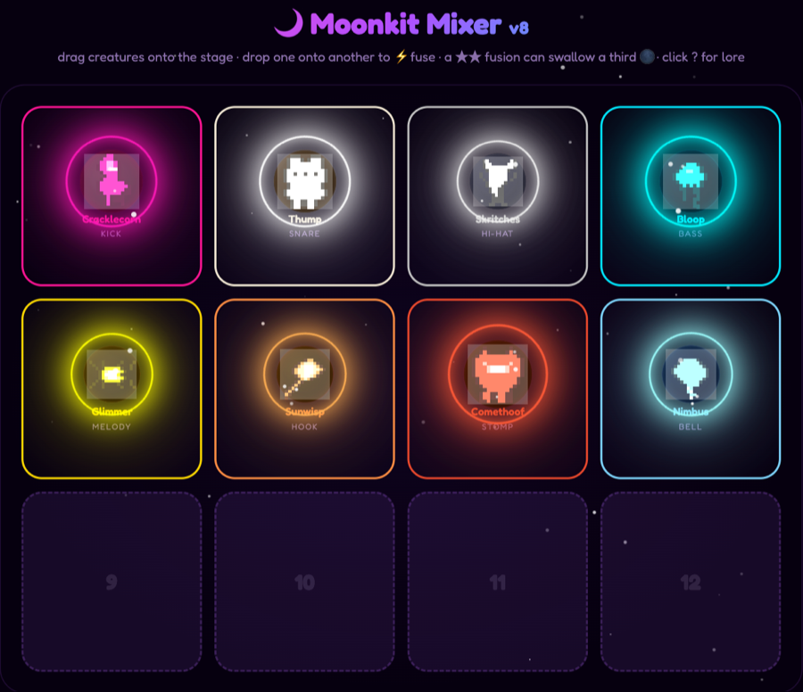

# 🌙 Moonkit Mixer

A cute-creepy music playground for kids — drag glowing little creatures onto a stage, build a groove, fuse them into wild new combos, and tune the whole thing live.

### [▶ Play it live](https://blackcorvidae.github.io/moonkit-mixer/)



## What it is

19 hand-drawn pixel creatures, each its own synthesized voice — kick, snare, bass, melody, pad, bell, growl, and more — built entirely with the Web Audio API. No samples, no libraries, no build step. Drag one onto the stage to add it to the loop, or long-press it and tap a slot if dragging isn't your thing (built with small hands and touchscreens in mind).

## Features

- **19 creatures** across 3 "phases", 2 anthem creatures (Sunwisp on lead HOOK, Comethoof on STOMP), and Echolotl the mimic
- **Echolotl repeats what you play** — tap a tune on the 🫧 Echo pads (or keys `1`–`8`, or a MIDI keyboard in jam mode) and the little axolotl loops it back in time with everyone else; see below
- **Echo dial** — a tempo-locked delay you can crank from dry to a hall of repeats
- **Fusion** — drop one creature onto another (⚡) or long-press-select and tap to fuse instead; fusions evolve the longer they play, and a fully evolved fusion can even swallow a third for a total eclipse 🌑
- **4 moods** — Dreamy, Spooky, Wild, and Sunny (bright and major, snaps melodies onto a Lydian scale)
- **Live Vibrato** mod-wheel and a **Chaos** dial that procedurally reshuffles patterns anywhere from sparse to wild, in real time
- **16-step sequencer** with tempo, reverb, and lo-fi controls
- **4 catalyst creatures** that transform the whole stage at once (Blessed, Cursed, Wild, Evil)
- **Shareable links** — the whole stage state lives in the URL, so a link is a save file
- **Installable PWA** — works offline, mobile-friendly
- **Hardware keyboard play** — plug in a MIDI keyboard (built for the M-VAVE FM-1) and hit 🎹 MIDI; see below
- Zero build step: plain ES modules, no framework, no bundler

## Controls

| Key | Action |
| --- | --- |
| `Space` | Play / stop |
| `S` | Shuffle patterns |
| `C` | Clear stage |
| `M` | Cycle mood |
| `R` | Cycle reverb |
| `L` | Toggle lo-fi |
| `Q` | Toggle sequencer |
| `1`–`8` | Play the Echo pads |
| `Esc` | Close lore card / cancel selection |

## Echolotl and the Echo pads

Click **🫧 Pads** (or just drop Echolotl on the stage) to open eight pads tuned to the same scale as every creature, so nothing you play sounds wrong. Play a few notes:

- Each note sounds straight away and lands on the nearest step of the loop. Echolotl hops on stage if it isn't there and sings your tune back every bar. The pads light up as it does.
- Keep playing to add notes. **Pause for two bars** and the next note starts a new tune that replaces the old one. **🧽 Forget** wipes it.
- Echolotl is a normal creature: it evolves, fuses, shows up in the step sequencer, and its tune is saved in share links. Shuffle and Chaos leave its tune alone.
- The **Echo** slider sets how much of the melodic creatures goes into the delay and how long it repeats. The delay is locked to the tempo (a dotted eighth).

## Playing from a MIDI keyboard

Click **🎹 MIDI** (Chrome or Edge — Safari has no Web MIDI), then play. Each key's note name picks a stage slot (C = slot 1 … B = slot 12, any octave):

| On the keyboard | What happens |
| --- | --- |
| Tap a key on an empty slot | A random creature that isn't on stage yet jumps in |
| Tap a key on an occupied slot | That creature re-rolls its pattern |
| Hold a key (~⅔ s) | Unfuses a fusion, or sends a creature home |
| Two keys together | The higher key's creature fuses into the lower key's |
| Three or more keys together | Shuffles every pattern |

That's **summon** mode. Click **🎹** again for **jam** mode: every key just plays its note, and Echolotl records and loops whatever you play, exactly like the Echo pads. With **🎛 Out** on, Echolotl plays your tune back on the synth itself. The mode is remembered per browser.

### Creatures playing the FM-1 (MIDI out)

Click **🎛 Out** to send the stage to a MIDI synth. It cycles **off → both** (browser + synth) **→ synth only** (browser muted); a short three-note blip confirms the synth can hear you.

Pick the channel with **🎚**:

- **Ch 1–16** — every creature plays on that one channel, through the synth's current sound. Set it to whatever channel your synth listens on (if you hear nothing, this is the first thing to check — the blip replays whenever you change it).
- **Ch 1–8 split** — for the M-VAVE FM-1 on firmware **V16**, whose 8 Voices each listen on their own channel. Set FM-1 Voice *n* to receive on MIDI channel *n*:

| Channel / FM-1 Voice | Creatures (by role) |
| --- | --- |
| 1 | kick, stomp |
| 2 | snare, clap, hi-hat |
| 3 | bass, sub, growl |
| 4 | melody, lead, pluck |
| 5 | arp, bell |
| 6 | pad, chord (sent as triads) |
| 7 | ambient, vocal |
| 8 | fx |

With the **Echo** slider at 40% or more, melodic creatures also repeat on the synth — one, two or three quieter repeats (at 40%, 65% and 90%), a dotted eighth apart.

Moods still bend the notes (Sunny snaps to Lydian), evolution raises velocity, the **Reverb** slider drives the FM-1's reverb (CC 4/7 on its FX channel, 2), and **Vibrato** sends mod wheel on channels 3–8. Stopping sends All Notes Off on all 16 channels. The channel choice is remembered per browser.

## Running locally

No build step — just serve the folder:

```sh
python3 -m http.server 8000
```

then open `http://localhost:8000`.

## Code layout

| File | What's in it |
| --- | --- |
| `js/data.js` | Creature, catalyst, and sprite definitions |
| `js/sprites.js` | Procedural pixel-sprite rendering + fusion visuals |
| `js/audio.js` | The synth engine — moods, the Sunny scale-snap, vibrato, one function per voice |
| `js/patterns.js` | Procedural pattern generator behind the Chaos dial |
| `js/state.js` | Stage state — add/remove/fuse, catalysts, share-link encode/decode |
| `js/sequencer.js` | The playback engine and step sequencer UI |
| `js/midi.js` | Web MIDI bridge — key gestures (tap, hold, chord) mapped onto the stage, jam mode, and MIDI out |
| `js/echo.js` | Echolotl — the Echo pads, recording a played tune onto the loop, share-link encoding |
| `js/ui.js` | Rendering + interaction — drag, touch, long-press-select, controls |
| `js/main.js` | Wires it all together |
