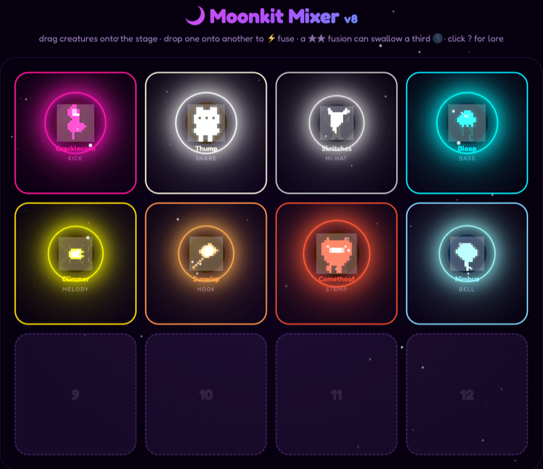

# 🌙 Moonkit Mixer

A cute-creepy music playground for kids — drag glowing little creatures onto a stage, build a groove, fuse them into wild new combos, and tune the whole thing live.

### [▶ Play it live](https://blackcorvidae.github.io/moonkit-mixer/)



## What it is

18 hand-drawn pixel creatures, each its own synthesized voice — kick, snare, bass, melody, pad, bell, growl, and more — built entirely with the Web Audio API. No samples, no libraries, no build step. Drag one onto the stage to add it to the loop, or long-press it and tap a slot if dragging isn't your thing (built with small hands and touchscreens in mind).

## Features

- **18 creatures** across 3 "phases" plus 2 anthem creatures (Sunwisp on lead HOOK, Comethoof on STOMP)
- **Fusion** — drop one creature onto another (⚡) or long-press-select and tap to fuse instead; fusions evolve the longer they play, and a fully evolved fusion can even swallow a third for a total eclipse 🌑
- **4 moods** — Dreamy, Spooky, Wild, and Sunny (bright and major, snaps melodies onto a Lydian scale)
- **Live Vibrato** mod-wheel and a **Chaos** dial that procedurally reshuffles patterns anywhere from sparse to wild, in real time
- **16-step sequencer** with tempo, reverb, and lo-fi controls
- **4 catalyst creatures** that transform the whole stage at once (Blessed, Cursed, Wild, Evil)
- **Shareable links** — the whole stage state lives in the URL, so a link is a save file
- **Installable PWA** — works offline, mobile-friendly
- **Hardware keyboard play** — plug in a MIDI keyboard (built for the M-VAVE FM-1) and hit 🎹 MIDI; see below
- Zero build step: plain ES modules, no framework, no bundler

## Controls

| Key | Action |
| --- | --- |
| `Space` | Play / stop |
| `S` | Shuffle patterns |
| `C` | Clear stage |
| `M` | Cycle mood |
| `R` | Cycle reverb |
| `L` | Toggle lo-fi |
| `Q` | Toggle sequencer |
| `Esc` | Close lore card / cancel selection |

## Playing from a MIDI keyboard

Click **🎹 MIDI** (Chrome or Edge — Safari has no Web MIDI), then play. Each key's note name picks a stage slot (C = slot 1 … B = slot 12, any octave):

| On the keyboard | What happens |
| --- | --- |
| Tap a key on an empty slot | A random creature that isn't on stage yet jumps in |
| Tap a key on an occupied slot | That creature re-rolls its pattern |
| Hold a key (~⅔ s) | Unfuses a fusion, or sends a creature home |
| Two keys together | The higher key's creature fuses into the lower key's |
| Three or more keys together | Shuffles every pattern |

## Running locally

No build step — just serve the folder:

```sh
python3 -m http.server 8000
```

then open `http://localhost:8000`.

## Code layout

| File | What's in it |
| --- | --- |
| `js/data.js` | Creature, catalyst, and sprite definitions |
| `js/sprites.js` | Procedural pixel-sprite rendering + fusion visuals |
| `js/audio.js` | The synth engine — moods, the Sunny scale-snap, vibrato, one function per voice |
| `js/patterns.js` | Procedural pattern generator behind the Chaos dial |
| `js/state.js` | Stage state — add/remove/fuse, catalysts, share-link encode/decode |
| `js/sequencer.js` | The playback engine and step sequencer UI |
| `js/midi.js` | Web MIDI bridge — key gestures (tap, hold, chord) mapped onto the stage |
| `js/ui.js` | Rendering + interaction — drag, touch, long-press-select, controls |
| `js/main.js` | Wires it all together |
